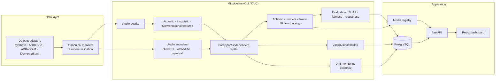

# CogniTrack AI

**Multimodal longitudinal speech intelligence for early cognitive change assessment.**

CogniTrack AI is an end-to-end, zero-budget machine learning platform. It analyses acoustic, linguistic and conversational characteristics of speech recordings and patient–clinician conversations. It also tracks how those characteristics change across repeated assessments of the same person.

> **Not a medical device.** CogniTrack AI is a research and clinical decision-support prototype. It never diagnoses. Every output is a statistical signal for review by a qualified clinician. See [docs/LIMITATIONS.md](docs/LIMITATIONS.md) and [docs/MODEL_CARD.md](docs/MODEL_CARD.md).

> **Synthetic data by default.** The restricted clinical corpora (ADReSSo, ADReSS-M, DementiaBank) need approved access, so the repository ships a **synthetic data generator**. Group differences and trajectories in that data are programmed in by construction. All results, reports and dashboard screens computed from it carry a "synthetic" label and **are not clinical evidence**.

---

## What it does

| Capability | Implementation |
|---|---|
| Data ingestion | Configurable dataset adapters → one canonical manifest schema (Pandera-validated), duplicate/missing/lineage checks, participant-independent splits |
| Audio quality | Silence, clipping, low SNR, truncation and corruption detection; unusable audio is excluded, never imputed |
| Acoustic features | F0 statistics, jitter, shimmer, HNR (openSMILE eGeMAPS or librosa proxies), energy, spectral shape, MFCCs, syllable-nuclei speech rate, VAD-based pause analysis |
| Linguistic features | spaCy (or rule-based fallback): TTR/MATTR/Brunet/Honoré, fillers, repetitions, pronouns, word-finding proxies, parse depth, clause density, incomplete sentences, semantic coherence |
| Conversational features | From dataset-provided speaker turns only: response latency, turn-taking, interruptions, balance, topic continuity |
| Representation learning | Pluggable audio encoders: HuBERT and wav2vec 2.0 (Hugging Face, explicit download) or a download-free spectral-statistics encoder. Content-addressed Parquet cache. |
| Modelling | Logistic regression, random forest, XGBoost, LightGBM, PyTorch MLP; early, late (stacked) and attention fusion; a 7-way modality ablation |
| Evaluation | Participant-grouped CV, post-hoc calibration on held-out participants, AUROC/AUPRC/sensitivity/specificity/F1/Brier/ECE, cluster-bootstrap CIs, paired fusion-vs-single test |
| Longitudinal engine | Personal baselines, z-scores against within-person variability, moving averages, trends, EWMA control charts, PELT and Bayesian change points, Isolation Forest anomalies |
| Responsible AI | SHAP (global, local, interactions), modality permutation importance, ensemble disagreement, Mahalanobis OOD, abstention, subgroup metrics with minimum-n rules, robustness to noise, gain, band-limiting, truncation and missing modalities, generated model card |
| MLOps | MLflow (local SQLite), DVC pipeline, Evidently + PSI/KS drift reports, Pytest, GitHub Actions |
| Application | FastAPI + SQLAlchemy + PostgreSQL (SQLite fallback), role-based API keys, consent-aware uploads, raw-audio deletion; React + TypeScript + Tailwind + Plotly dashboard with 8 pages |

## Architecture at a glance



Full design: [docs/ARCHITECTURE.md](docs/ARCHITECTURE.md) · decisions: [docs/adr/](docs/adr/).

## Quick start (local, no Docker)

Requires Python 3.11+, Node 20+. CPU only.

```bash
python -m venv .venv
```

```bash
.venv/Scripts/activate        # Windows (macOS/Linux: source .venv/bin/activate)
```

```bash
pip install -e ".[audio,nlp,dev]" torch
```

```bash
python -m spacy download en_core_web_sm
```

```bash
cognitrack run-all --quick --workers 4
```

```bash
uvicorn backend.app.main:app --port 8000
```

```bash
cd frontend && npm install && npm run dev
```

Open http://localhost:5173. `run-all --quick` generates a 40-participant synthetic cohort, extracts features, trains the experiment grid, writes all reports and publishes them into the local SQLite database (`data/cognitrack.db`). On a laptop CPU it takes roughly 10–20 minutes, most of it feature extraction and the experiment grid. Drop `--quick` for the default 72-participant cohort.

### With Docker

```bash
docker compose up --build -d
```

```bash
docker compose --profile pipeline run --rm pipeline
```

Dashboard: http://localhost:8080 · API docs: http://localhost:8000/docs. Details and GPU notes: [docs/DEPLOYMENT.md](docs/DEPLOYMENT.md).

## Pipeline commands

| Stage | Command |
|---|---|
| Synthetic data | `cognitrack generate-synthetic` |
| Ingest + validate | `cognitrack ingest` |
| Features | `cognitrack extract-features --workers 4` |
| Embeddings | `cognitrack embed --encoder spectral_stats` (or `hubert` / `wav2vec2` after `cognitrack download-models --embeddings`) |
| Splits | `cognitrack build-dataset` |
| Train | `cognitrack train` |
| Evaluate | `cognitrack evaluate` |
| Longitudinal | `cognitrack longitudinal` |
| Drift | `cognitrack monitor` |
| Robustness | `cognitrack robustness` |
| Publish to DB | `cognitrack publish` |
| Everything | `cognitrack run-all` (or `dvc repro`) |

Experiment tracking UI: `mlflow ui --backend-store-uri sqlite:///mlruns/mlflow.db`.

## Evaluation methodology (summary)

* Train, validation and test partitions are **participant-independent**. This is enforced in code (`assert_no_leakage`) and covered by tests.
* The serving model is chosen by **participant-grouped CV on the training partition**. Among configurations within 0.01 AUROC of the best, the **simplest** wins, so extra complexity must earn its place.
* Probabilities are calibrated on validation participants. The test partition is used once, and its confidence intervals come from a participant-level cluster bootstrap.
* Fusion is only called "better" if the paired bootstrap interval of the AUROC difference excludes zero.

The generated comparison of every run lives in `docs/reports/model_comparison.md` and is regenerated each time. Methodology: [docs/MODEL_EVALUATION.md](docs/MODEL_EVALUATION.md).

## Repository layout

```
ml/            data adapters · preprocessing · audio · nlp · embeddings · features · models · fusion
               longitudinal · explainability · evaluation · monitoring · training · inference
pipelines/     CLI and pipeline stages (ingestion, features, dataset, evaluation, analytics)
backend/app/   FastAPI app: api · core (config, security, errors) · database · models (ORM) · schemas · services
frontend/      React + TypeScript + Vite + Tailwind + Plotly dashboard
configs/       default.yaml (single source of pipeline parameters; DVC params)
data/          raw · interim · processed · synthetic   (git-ignored; DVC-tracked)
docs/          architecture, governance, model card, ADRs, generated reports
tests/, backend/tests/   unit, integration and API tests
```

## Documentation

[Architecture](docs/ARCHITECTURE.md) · [Data dictionary](docs/DATA_DICTIONARY.md) · [Data governance](docs/DATA_GOVERNANCE.md) · [Model card](docs/MODEL_CARD.md) · [Experiment tracking](docs/EXPERIMENT_TRACKING.md) · [API](docs/API_DOCUMENTATION.md) · [Model evaluation](docs/MODEL_EVALUATION.md) · [Deployment](docs/DEPLOYMENT.md) · [Contributing](docs/CONTRIBUTING.md) · [Limitations](docs/LIMITATIONS.md) · [Security](docs/SECURITY.md)

## Limitations and future work

The main limitations are small, mostly English and mostly cross-sectional public corpora; confounding by education, dialect and recording conditions; ASR bias; and low statistical power for change detection over a few sessions. The roadmap covers external validation on licensed corpora, learned VAD and diarisation, Alembic migrations, async job workers and fine-tuning of speech encoders when GPU budget allows. See [docs/LIMITATIONS.md](docs/LIMITATIONS.md) and the "Future improvements" section of [docs/ARCHITECTURE.md](docs/ARCHITECTURE.md).

## License

Code: Apache-2.0. Datasets keep their own licences and access terms; none are redistributed here.
