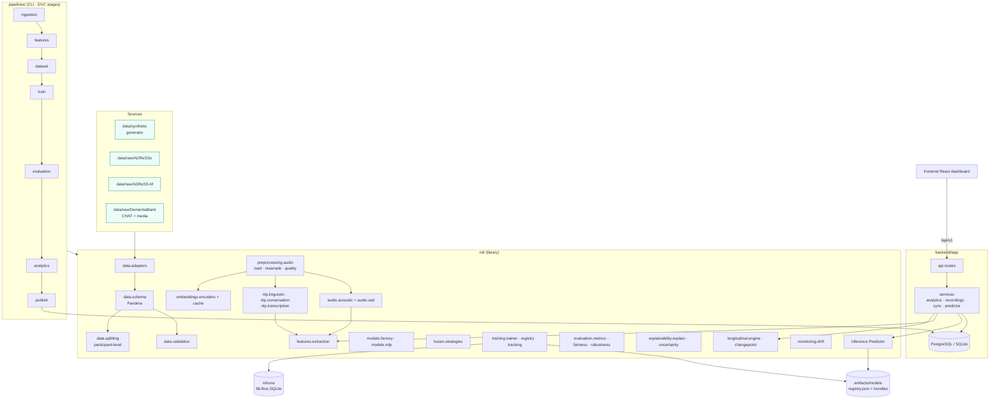
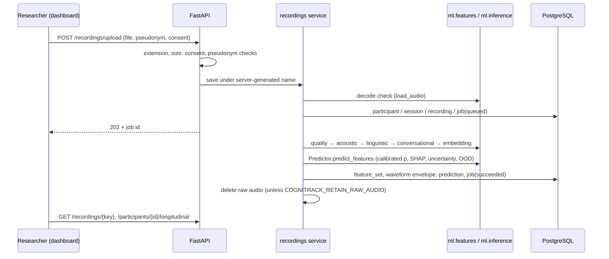
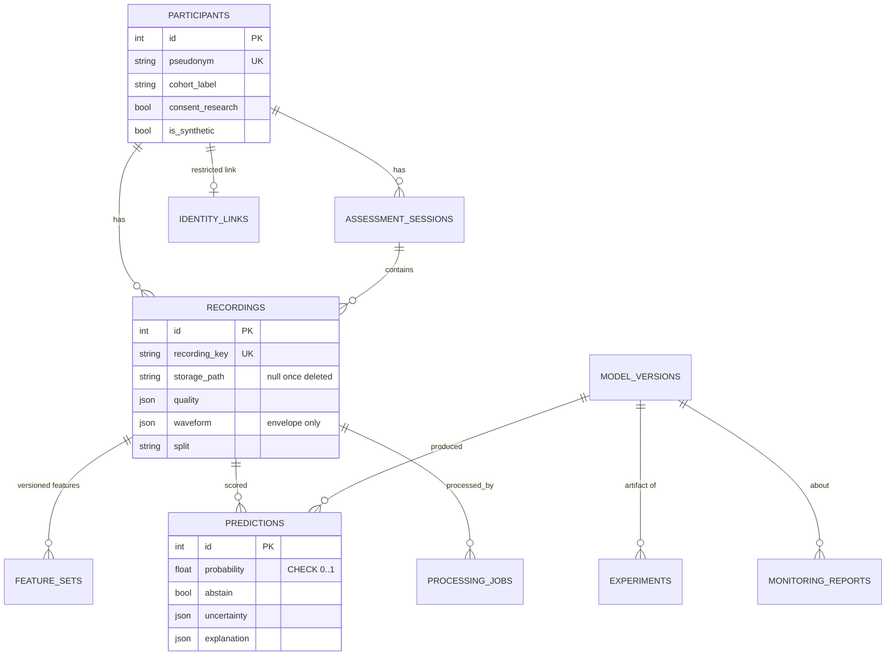

# Architecture

This document describes the system design of CogniTrack AI for technical review. It covers the components and the data flow, why each technology was chosen, compute and storage needs, how the system scales, and what comes next.

## 1. Design principles

1. **Zero budget, local first.** Every component runs on a laptop CPU with open-source software. GPU (Colab/Kaggle) is optional and only speeds up pretrained encoders.
2. **Honest by construction.** Missing data stays missing, labels are never inferred, and synthetic results are labelled at every layer: report JSON, database rows and UI badges. Unusable audio is excluded rather than repaired.
3. **One implementation per concept.** Feature extraction, inference and longitudinal analysis live in `ml/` and are called by both the batch pipeline and the API, so nothing is duplicated.
4. **Configuration-driven and reproducible.** `configs/default.yaml` holds every parameter. DVC uses it as the params file. Seeds, config hashes and dataset fingerprints are recorded with every experiment.
5. **Graceful degradation.** Optional dependencies each fall back to a working path with a recorded backend name: openSMILE, spaCy, sentence-transformers, torch, HuBERT and Whisper. Without a trained model the API returns HTTP 503 with an instruction.

## 2. Component view

### 2.1 Data flow of one recording

## 3. Data architecture

* **Canonical manifest** (`ml/data/schema.py`): one row per recording with participant, session and recording IDs, provenance JSON, and label/score only where the dataset supplies them. See [DATA_DICTIONARY.md](DATA_DICTIONARY.md).
* **Feature store:** Parquet files in `data/processed/`.
  * `features.parquet`: handcrafted features plus quality flags and backend names.
  * `embeddings.parquet` and `embedding_cache.parquet`: keyed by audio SHA-256 and encoder version.
  * `dataset.parquet`: manifest + features + split.
  * `predictions.parquet`
* **Versioning:**
  * DVC tracks data and pipeline stages.
  * `dataframe_fingerprint` gives each manifest a dataset version that is stored with every experiment, model version and report.
  * Feature sets in the database carry a `feature_version` (hash of extraction-relevant config).

### 3.1 Database

Key properties of the schema:

* **Pseudonymous research data.** `participants` holds no direct identifiers.
* **Restricted identity links.** `identity_links` is separate, never exposed by the API and empty for public or synthetic data.
* **Integrity.** Natural keys are unique; foreign keys cascade or set null as appropriate; check constraints cover probabilities and durations.
* **Indexes** cover the dashboard's access paths: participant/session, report type and time, prediction recording and time.
* **Versioned reports.** `monitoring_reports` keeps pipeline report payloads (JSONB on PostgreSQL), so every published version is retained.
* **Audit trail.** `audit_events` logs who (by role) read or changed participant-level resources. It stores no request bodies.

## 4. ML architecture

### 4.1 Feature engines

| Engine | Inputs | Notes |
|---|---|---|
| Acoustic | waveform (participant turns only when attributed) | YIN F0 with autocorrelation voicing; openSMILE eGeMAPS jitter/shimmer/HNR or documented librosa proxies; syllable-nuclei rate; energy VAD with gap bridging |
| Linguistic | transcript (dataset or Whisper) | spaCy POS/dependency features; length-robust lexical diversity (MATTR, Brunet, Honoré); TF-IDF or sentence-transformer coherence |
| Conversational | dataset speaker turns | never inferred from unattributed audio |
| Embeddings | waveform | `AudioEncoder` interface; HuBERT/wav2vec2 mean-pooled with padding-aware masks; spectral-stats fallback |

Raw counts that scale with recording length (`word_count`, `pause_count`, …) are kept for display but excluded from model inputs.

### 4.2 Experiment grid

Every run uses the same protocol:

1. 7 modality sets × 5 models (single or early fusion).
2. Late fusion (stacking on out-of-fold, participant-grouped base predictions) for the multi-modality sets.
3. Attention fusion (PyTorch, availability-masked modality attention with modality dropout).

Embedding inputs pass through PCA *inside* the pipeline, so dimensionality reduction never sees validation or test participants. See [MODEL_EVALUATION.md](MODEL_EVALUATION.md).

### 4.3 Serving

`ml/inference.Predictor` loads the serving bundle and the ensemble members from the local registry. It then returns:

* the calibrated probability;
* a model label phrased as a signal ("elevated_signal"), not a diagnosis;
* a local explanation: SHAP, late-fusion modality log-odds or attention weights, depending on the model type;
* an uncertainty assessment: abstention band, ensemble disagreement, Mahalanobis OOD, missing features and quality flags.

### 4.4 Longitudinal engine

The engine works on per-session aggregates. Deviations are scaled by the **population within-person SD**, which is more stable than a personal SD estimated from 2–3 baseline sessions. The engine computes:

* EWMA control limits around the personal baseline;
* PELT on the multivariate z-series;
* a Bayesian change-point posterior over where the current regime began;
* Isolation Forest scores on baseline-relative deviation vectors across the cohort.

The API recomputes a participant's analysis live from database features, so new uploads appear immediately.

## 5. Technology choices

| Concern | Choice | Why | Alternatives considered |
|---|---|---|---|
| Tabular ML | scikit-learn, XGBoost, LightGBM | strong small-data baselines, fast on CPU, native SHAP support | CatBoost (heavier); deep tabular models (weak at this sample size) |
| Deep learning | PyTorch | MLP and attention fusion; HF encoders | TensorFlow |
| Speech SSL | HuBERT (primary), wav2vec 2.0 (comparator) | well-studied self-supervised representations; base models fit on CPU | WavLM (similar, add via `AudioEncoder`) |
| ASR | Whisper (HF Transformers, local) | open weights, robust; `tiny.en` runs on CPU | Vosk (lower accuracy) |
| Acoustic | librosa + openSMILE | librosa is pure Python; eGeMAPS is a standard paralinguistic set | Praat/parselmouth (GPL concerns, extra dependency) |
| NLP | spaCy | fast and deterministic, small English model | Stanza (slower) |
| Validation | Pandera | declarative DataFrame schemas | Great Expectations (heavier) |
| Tracking | MLflow (SQLite backend) | local UI, registry, no server | W&B (hosted/paid) |
| Versioning | DVC | git-native data and pipeline versioning, no service | LakeFS |
| Drift | Evidently + custom PSI/KS | HTML reports plus testable, dependency-free core metrics | NannyML |
| API | FastAPI + Pydantic + SQLAlchemy 2 | typed, OpenAPI docs, async-capable | Django (heavier) |
| DB | PostgreSQL (SQLite fallback) | JSONB, constraints, free; SQLite enables Docker-free use | — |
| UI | React + TS + Vite + Tailwind + Plotly | typed, fast builds; Plotly provides ROC/PR/heatmaps out of the box | Streamlit (less control, weaker for app UX) |

ADRs with full reasoning: [adr/](adr/).

## 6. Classical ML vs deep learning trade-offs

Public cognitive-speech corpora contain on the order of 10² participants. At that scale:

* gradient-boosted trees and regularised linear models on interpretable features are usually as accurate as neural models and are far more stable;
* pretrained SSL embeddings help only through *frozen* features plus strong regularisation; here, PCA happens inside the CV pipeline;
* end-to-end fine-tuning overfits unless data or augmentation grow, so it is an optional path (see Future improvements).

The selection rule (simplest model within 0.01 CV AUROC of the best) puts this trade-off into code.

## 7. Compute and storage

| Workload | CPU (8-core laptop) | GPU (Colab T4) |
|---|---|---|
| Synthetic generation, 72 participants | ~5 min | — |
| Feature extraction, ~300 × 25 s recordings | ~0.8 s/recording warm (+~40 s JIT/model warm-up per process) | — |
| Spectral-stats embeddings | seconds | — |
| HuBERT-base embeddings (30 s clips) | ~1–2 s/clip | ~0.1 s/clip |
| Whisper tiny.en ASR | ~0.5× real time | ≫ real time |
| Experiment grid (~45 experiments) | ~5–15 min | — |

Storage:

* The synthetic cohort at 16 kHz/16-bit is about 0.5 MB per 15 s.
* Features run to a few MB.
* HuBERT-base is about 360 MB and Whisper tiny about 150 MB, both in `artifacts/checkpoints`; they are never committed or auto-downloaded.
* The database holds features (JSON), envelopes and reports. Per recording that is well under 100 KB.

## 8. Scalability considerations

* **Batch.**
  * Feature extraction is embarrassingly parallel (`--workers`).
  * Embeddings are cached by content hash.
  * DVC skips unchanged stages.
  * For more data, swap the process pool for a job queue such as Celery/RQ with Redis (free and self-hostable) without changing `ml/`.
* **Online.**
  * Uploads use FastAPI background tasks. Moving to a dedicated worker means swapping the task runner; the `ProcessingJob` table already models job state.
  * The predictor is a process-wide cache, so uvicorn workers scale horizontally because the database and registry are shared.
* **Storage.**
  * Parquet partitioning by dataset/source is a drop-in change.
  * PostgreSQL JSONB feature sets could move to a wide typed table or a feature store if query patterns demand it.

## 9. Known limitations of the architecture

* Schema migrations use `create_all`; production needs Alembic.
* There is no streaming inference; uploads are processed as whole files.
* The energy VAD is not robust to strong background speech; diarisation is not implemented, by design (speaker turns are never invented).
* The local registry and MLflow are kept in sync by the trainer; a single source of truth (MLflow registry aliases) is a planned simplification.

## 10. Future improvements

1. External validation on licensed ADReSSo / DementiaBank data, with pre-registered analysis.
2. Learned VAD (Silero) and optional diarisation that is clearly flagged as *estimated* and kept out of conversational features unless validated.
3. Fine-tuning HuBERT/WavLM with participant-grouped CV and augmentation (GPU notebook).
4. Mixed-effects models for longitudinal trajectories (statsmodels), with practice and task effects.
5. Conformal prediction for distribution-free coverage guarantees on abstention.
6. Alembic migrations, OpenTelemetry tracing, and OIDC instead of API keys.
